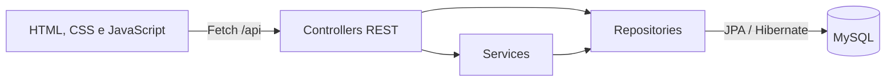
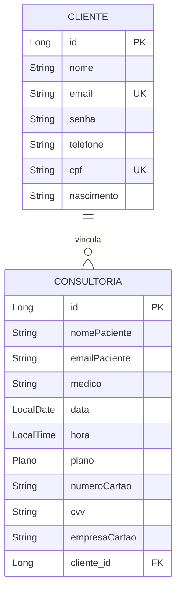

# Arquitetura e dados

[Voltar ao README](../README.md) · [API](API.md) · [Execução](EXECUCAO.md)

## Visão geral

O sistema é um monólito Spring Boot: o mesmo servidor entrega os arquivos estáticos e atende a API. Não há projeto frontend separado nem etapa de build JavaScript.

A listagem de consultorias e o login acessam os repositórios diretamente pelo controller.

## Componentes

| Componente | Responsabilidade |
| --- | --- |
| `ConsultoriaApplication` | Inicialização do Spring Boot |
| `ClienteController` | Cadastro e resposta de sucesso/erro |
| `LoginController` | Busca por e-mail, comparação de senha e resposta de login |
| `ConsultoriaController` | Listagem, criação e exclusão |
| `ClienteService` | Limites de tamanho e duplicidades |
| `ConsultoriaService` | Vínculo com cliente, conflito de horário e exclusão |
| `ClienteRepository` | CRUD JPA, busca por e-mail e verificações de existência |
| `ConsultoriaRepository` | CRUD JPA e conflito por profissional/data/hora |

O código fica em `src/main/java/com/maisVida/consultoria`. Não há camada de DTO, configuração de segurança ou tratamento global de exceções.

## Modelo de domínio

O diagrama representa o vínculo esperado pelo serviço: cada nova consultoria exige um cliente existente, que pode ter várias consultorias. No mapeamento, `@ManyToOne` e `@JoinColumn(name = "cliente_id")` não definem `optional=false` nem `nullable=false`; essa obrigatoriedade não está explicitada na entidade.

- `Cliente` usa a tabela explícita `cliente`. Os IDs usam `GenerationType.IDENTITY`.
- `Consultoria` recebe nome de tabela pela estratégia do Hibernate e não define restrições explícitas de nulidade nos campos.
- `Plano` é enum persistido como texto: `SEMANAL`, `MENSAL`, `ANUAL`.
- `nascimento` é texto; data e hora da consultoria são tipos Java sem fuso horário.
- Nome de cliente duplicado é bloqueado no serviço. E-mail e CPF também têm unicidade declarada na entidade.
- Profissionais são opções fixas do HTML, sem tabela ou endpoint próprio.

O Hibernate atualiza o esquema com `ddl-auto=update`. Não há migrações versionadas ou scripts de carga inicial no repositório.

## Fluxos

### Cadastro e login

1. `cadastro_cliente.js` valida campos preenchidos e alguns limites de tamanho.
2. `POST /api/clientes` verifica as regras do serviço e salva o cliente.
3. `POST /api/login` busca o e-mail e compara a senha em texto simples.
4. `login.js` guarda `clienteId` no `localStorage` e abre `/index.html`.

O ID salvo não é enviado como credencial nas chamadas de consultoria. Não há sessão, token, logout implementado ou proteção de acesso às páginas.

### Agendamento

1. `nova_consultoria.js` envia os dados, preenchendo `cliente.email` com `emailPaciente`.
2. O serviço busca o cliente no banco e substitui o objeto recebido pela entidade encontrada.
3. Verifica se o mesmo profissional possui consultoria na mesma data e hora.
4. Salva e retorna a entidade com o cliente vinculado.

Não há preço calculado, renovação automática de plano, duração do atendimento, confirmação por mensagem ou processamento de cartão.

### Listagem e exclusão

1. `tabela_consultorias.js` carrega todas as consultorias com GET.
2. Monta a tabela e filtra por profissional no navegador.
3. Após confirmação no navegador, envia DELETE com o ID.
4. O serviço verifica a existência, remove o registro e a tela recarrega a lista.

Não existe status de atendimento ou exclusão lógica: a exclusão é permanente.

## Limitações e evolução

A API recebe e devolve entidades de persistência diretamente. As respostas de consultoria incluem senha, CPF e dados de cartão. Não há autenticação ou verificação de propriedade para listar ou excluir registros.

Evoluções pendentes incluem DTOs, autenticação e autorização, proteção de senhas, remoção do armazenamento de CVV, integração com provedor de pagamento, validações no backend e testes das regras de negócio. Esses itens não estão implementados nesta versão.
